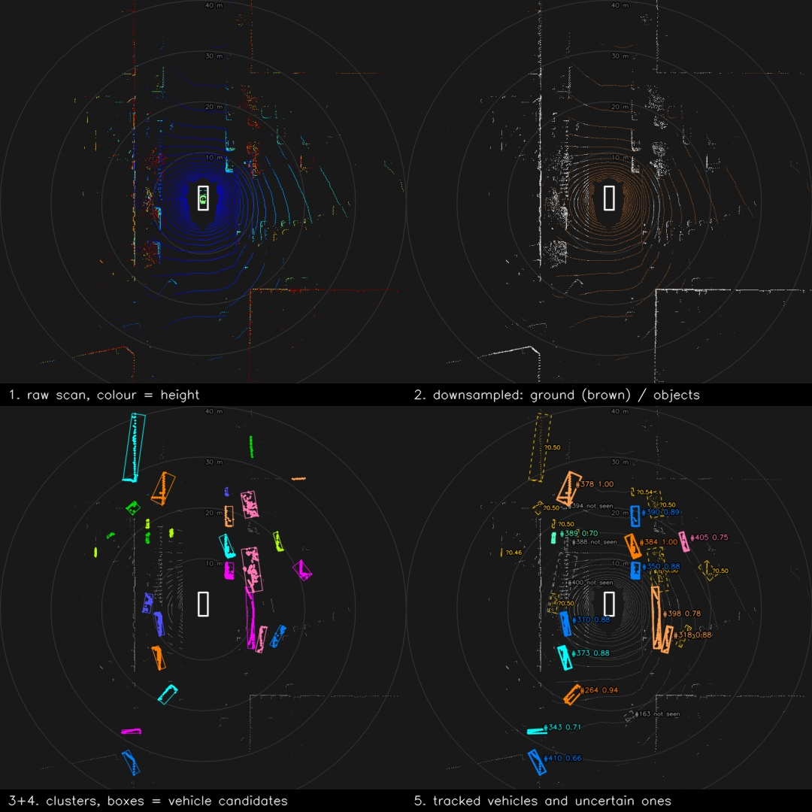
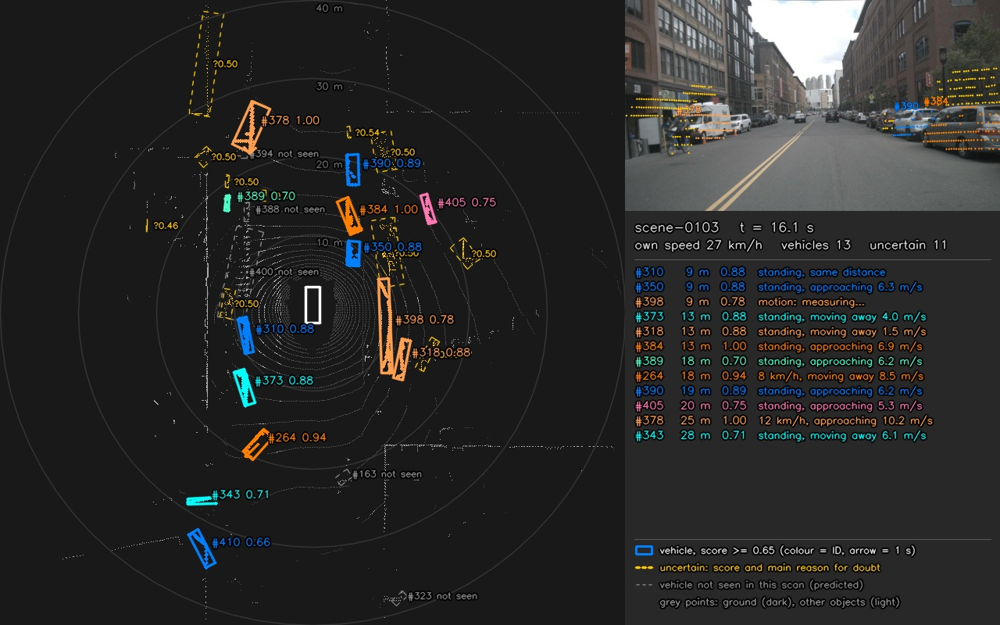

# Finding Vehicles in LiDAR Point Clouds (Optional Homework)

This project finds vehicles in short LiDAR sequences from the nuScenes mini dataset. For every scan it shows which points belong to which vehicle. Each vehicle gets a box, an ID that stays the same from scan to scan, a confidence score with the reason for any doubt, its speed, and whether it is approaching us or moving away.

All of it is classical point cloud processing with NumPy, SciPy and scikit-learn: cropping, voxel downsampling, ground removal, DBSCAN clustering, box fitting, simple rules and a small tracker. There is no neural network. The nuScenes labels are **not** used for detection. I only used them while tuning, to count hits and misses (section 7).

A short report with pictures (what was submitted, how to run it, results, ODD) is in [docs/Report.pdf](docs/Report.pdf).



---

## 1. What is where

```
Optional_Assignment_LiDAR_Vehicle_Detection/
│
├── run_detection.py         main script: one scene in -> annotated video out
├── save_pipeline_steps.py   saves one picture per pipeline step for a chosen moment
├── get_nuscenes_mini.py     downloads nuScenes mini and keeps only what we need
│
├── settings.py              every tuned number, with a comment on why
├── nuscenes_data.py         reads the nuScenes tables, scans, poses and calibration
├── point_processing.py      step 1 crop + downsample, step 2 ground removal
├── clustering.py            step 3 DBSCAN clusters, step 4 box fit + vehicle rules + shape score
├── tracker.py               step 5 tracking: IDs, speed, approaching / moving away, confidence
├── pipeline.py              glues steps 1-5 together for one scan
├── drawing.py               all the drawing (bird's-eye view, camera, list, step views)
│
├── data/nuscenes-mini/      the dataset (created by get_nuscenes_mini.py, not in git: too big)
├── output/                  full videos (created by run_detection.py, not in git)
├── clips/                   the videos picked for the submission (good case + limitations)
├── screenshots/             pictures of every pipeline step for a few moments
├── docs/                    short report (Word + PDF)
└── requirements.txt
```

**Data:** [nuScenes](https://www.nuscenes.org/) v1.0-mini: 10 scenes of 20 s from Boston and Singapore, recorded with a 32-beam Velodyne HDL-32E on the roof (20 scans per second). I only use the `LIDAR_TOP` scans and the poses. The front camera picture is shown next to the result so a viewer can check it, but the detection never looks at it.

---

## 2. How to run it

Python 3.10 or newer.

```bash
pip install -r requirements.txt

# 1. Get the data (once). Downloads ~4 GB but only keeps ~300 MB per scene.
python get_nuscenes_mini.py                          # the 5 demo scenes
python get_nuscenes_mini.py --scenes all             # all 10 scenes (~3 GB)
python get_nuscenes_mini.py --archive ../v1.0-mini.tgz   # if you already downloaded the archive

# 2. Run the detection on a scene
python run_detection.py --list                       # show the scenes with a description
python run_detection.py scene-0103                   # -> output/scene-0103_vehicles.mp4
python run_detection.py scene-0103 --diagnostic      # also output/scene-0103_diagnostic.mp4
python run_detection.py scene-0655 --start 5 --end 12 --output output/parking.mp4

# 3. Pictures of every pipeline step at one moment
python save_pipeline_steps.py scene-0103 --time 16   # -> screenshots/scene-0103_16s/
```

Run the scripts from inside the project folder (the data path `data/nuscenes-mini` is relative). `--data` points them somewhere else. A 20 s scene takes a few minutes with `--diagnostic` (writing the videos is the slow part).

---

## 3. What the video shows



**Left, bird's-eye view** (80 m x 80 m, our car is the white box in the middle, facing up, rings every 10 m):

* **Coloured points + solid box** = a confident vehicle. The colour belongs to its track ID, so the same car keeps the same colour. Label: `#ID confidence`. The arrow shows where it will be in 1 s.
* **Amber dashed box** `?0.50` = an uncertain candidate. It is shaped like a vehicle, but something is doubtful (the list gives the reason).
* **Grey dashed box** `#ID not seen` = a vehicle that was confirmed before but is missing in this scan (hidden behind something). Its position is predicted for up to 5 scans.
* Dark grey points are ground and light grey points are other objects (walls, trees, people, poles).

**Right:** the front camera picture with the vehicle points projected into it (same colours), and the vehicle list: ID, distance, confidence and motion, for example `standing, approaching 6.3 m/s` or `25 km/h, moving away 1.2 m/s`. "Approaching" and "moving away" are about the distance between that vehicle and our car, so a parked car we drive towards is "standing, approaching".

---

## 4. How it works

Each scan goes through five steps. `save_pipeline_steps.py` saves a picture of each one.

### Step 1: crop and downsample (`point_processing.py`)

A scan has about 35 000 points. I keep the 80 m x 80 m square around our car, because beyond 40 m a car only gets a handful of points. Points on our own car (roof, mirrors) are removed with a fixed box.

Then **voxel downsampling**: space is cut into 15 cm cubes and each cube keeps one point, the average of its points. Close objects get thousands of points and far ones only a few. Downsampling evens this out and makes clustering much faster.

### Step 2: ground removal (`point_processing.py`)

The ground has to go first, otherwise the road connects every car into one big cluster.

My **first try** was one flat plane fitted with RANSAC (pick 3 random points, count how many points lie near their plane, keep the best plane). Close to the car that worked. But roads are not flat over 40 m: they have slopes, camber and kerbs. Far cars sat below or above the plane, and my rules rejected them as "too low" or "floating".

The **final version** estimates the ground height locally on a grid of 2 m cells:

1. The lowest point in each cell is a guess of the road height there.
2. A cell whose guess is more than 0.3 m below the median of its neighbours is a stray point and gets that median instead (see the bug below).
3. Each cell takes the lowest guess of itself and its 8 neighbours. A cell completely covered by a car has no road points, but its neighbours usually do.
4. Cells without any points get the median height.

**A bug I found late.** A few single points lie up to 1 m *below* the road (most likely reflections). Step 3 spread such a point to all 9 cells around it, so the real road in a 6 x 6 m area looked 0.7-0.9 m high. It became one big "object" that swallowed the vehicles next to it. In scene-0553 the truck, its trailer and the car beside us vanished into a 10 x 10 m blob around our own car, and only 21% of the vehicles in that scene were found. At first I blamed DBSCAN for merging touching vehicles. Drawing the rejected clusters showed the blob was centred on our own car, and the ground map had holes of -0.95 m in it. Step 2 fixes it: 21% -> 54% in that scene, 61% -> 65% overall.

Every point now has a **height above the local ground**. Points below 25 cm are ground. I also drop everything above 2.5 m and only cluster the "vehicle body layer". Tree crowns, signs and traffic lights hang over parked cars, and without this cut a tree glued three parked cars into one 15 m blob.

### Step 3: clustering (`clustering.py`)

**DBSCAN** on the bird's-eye (x, y) positions: points closer than 0.7 m are neighbours, and chains of neighbours form a cluster. Points in thin areas become noise. I cluster in 2D, not 3D, because the 32 laser rings are far apart vertically at a distance. In 3D a far car splits into horizontal slices, but seen from above the slices lie on top of each other.

### Step 4: box and vehicle rules (`clustering.py`)

Each cluster gets the **smallest rectangle** around it seen from above. I try every angle from 0 to 90 degrees in 2 degree steps, rotate the points and keep the angle that gives the smallest area. The box gives length, width and heading. The heights above ground give the top and bottom of the cluster.

**Hard rules** throw out what can't be a vehicle: fewer than 8 points, lower than 0.9 m, floating (lowest point more than 0.8 m above ground), shorter than 1.4 m (people, poles), longer than 14 m, wider than 3.8 m, or long and paper-thin (a wall seen along its length).

The rest are **vehicle candidates**. Each gets three score parts between 0 and 1:

| part | 1.0 | lower |
|---|---|---|
| points | 60 or more points | fewer, scaled down ("few points" below 30) |
| size | car (3.2-5.8 x 1.4-2.3 m) or van/truck/bus (5.8-14 x 2.0-3.2 m) | 0.5 smaller ("partial view": often we only see one side of a car), 0.3 unusual |
| height | roof between 1.2 and 2.1 m | 0.5 lower ("low"), 0.3 taller ("tall: truck or wall?") |

### Step 5: tracking, speed and confidence (`tracker.py`)

Our car moves. If I compared positions in our own frame, a parked car would seem to drive towards us at our speed. So each detection is first moved into the fixed **world frame** with our pose for that scan (ego-motion compensation). There a parked car stays put.

Each scan:

1. Every track predicts where its vehicle should be now (last position + velocity x time).
2. Detections are matched to tracks, closest pairs first, only if closer than 2 m.
3. Matched tracks take the new position. Unmatched tracks count a miss and are deleted after 5 misses. Unmatched detections start a new track with a new ID.

From the positions over the last second (a straight-line fit, which smooths the jitter of the box centre) a track gets its **speed** over ground. The same fit on the distance between the track and our car gives the **range rate**: negative means approaching.

**Confidence** is the average of the three shape parts and a fourth "tracking" part, which grows with the number of scans the vehicle was seen in (full after 8). Status:

* **vehicle**: seen in at least 3 scans and confidence of at least 0.65
* **uncertain**: everything else (drawn only from 0.45 up)
* **held**: not seen in this scan

**Tall clusters.** Most confident false alarms in my first tests were walls, hedges and bushes. They are about as long as a car and reach the top of the 2.5 m layer. Vans, trucks and buses do too, and from one scan the two can't be told apart. So a tall cluster standing still is capped at 0.5 and stays "uncertain" (`tall: truck or wall?`). Once it drives faster than 3 m/s over at least 8 scans, it must be a vehicle and the doubt goes away. I didn't use a lower speed threshold: the visible piece of a wall changes as we drive past, so its box slides along at a few km/h.

---

## 5. Results

### Demo videos (`clips/`)

| clip | scene | what it shows |
|---|---|---|
| `01_good_city_street` | scene-0103, Boston | A street with parked cars on both kerbs and a few moving cars. The parked cars are picked up as we approach, keep their ID and colour while we pass, and are "standing, approaching", later "moving away". Moving cars get a speed and an arrow. Building walls stay amber or are rejected. |
| `02_good_night_high_speed` | scene-1077, Singapore | Night, about 50 km/h. The camera sees little, but the LiDAR brings its own light. Oncoming cars are found with their speed (about 40 km/h) and a long "approaching" arrow. The trees and bushes along the road stay amber, which is the right call here. |
| `03_limit_bus_and_trucks` | scene-0655, Boston | The first half works well: parked cars on both sides of the street. Then an articulated bus passes right beside us. Its 17.8 m cluster is rejected as "too long", and two parked utility trucks on the left stay amber ("tall: truck or wall?"). At 16 s there are 0 confident vehicles while three big ones are right next to us. |
| `04_limit_bushes_at_night` | scene-1100, Singapore | We wait at a junction at night. Bushes, fences and other objects along the road have about the size of a car, and many become confident "vehicles" (standing, same distance). At 10 s only 2 of the 14 confident tracks are real vehicles. This scene has the worst precision (0.18). |

Each clip also has a `_diagnostic` version with four pipeline steps side by side.

### Numbers (all 10 nuScenes mini scenes, 404 key frames)

Checked against the nuScenes labels as described in section 7. A "labelled vehicle" is a car, van, truck, bus, trailer or construction vehicle inside the 80 m square with at least 10 LiDAR points on it. Precision, recall and F1 count only the **confident** vehicles, because those are what the system claims are vehicles:

* precision = confident tracks that match a labelled vehicle / all confident tracks
* recall = labelled vehicles matched by a confident track / all labelled vehicles
* "found" also counts uncertain tracks (amber boxes) that match a labelled vehicle

| scene | labelled | found (confident or uncertain) | precision | recall | F1 |
|---|---|---|---|---|---|
| 0061 Singapore, parked truck, construction | 234 | 170 (73%) | 0.37 | 0.32 | 0.34 |
| 0103 Boston, city street | 400 | 289 (72%) | 0.72 | 0.46 | 0.56 |
| 0553 Boston, truck at intersection | 252 | 137 (54%) | 0.35 | 0.30 | 0.33 |
| 0655 Boston, parked cars, bendy bus | 703 | 449 (64%) | 0.76 | 0.34 | 0.47 |
| 0757 Boston, busy intersection | 258 | 144 (56%) | 0.43 | 0.35 | 0.39 |
| 0796 Singapore, overtaking car | 144 | 110 (76%) | 0.56 | 0.59 | 0.57 |
| 0916 Singapore, parking lot | 765 | 478 (62%) | 0.70 | 0.43 | 0.54 |
| 1077 Singapore, night, high speed | 255 | 171 (67%) | 0.57 | 0.42 | 0.48 |
| 1094 Singapore, night after rain | 299 | 215 (72%) | 0.45 | 0.46 | 0.46 |
| 1100 Singapore, night, bushes | 204 | 123 (60%) | 0.18 | 0.44 | 0.26 |
| **all** | **3514** | **2286 (65%)** | **0.50** | **0.40** | **0.45** |

* About **2 out of 3** labelled vehicles are found. 40% are confident vehicles; the other 25% are amber "uncertain" boxes, mostly tall parked vans and trucks ("truck or wall?") or cars seen for the first time.
* **Precision 0.50:** half of the confident vehicles are real. When I looked at the false ones in the debug view, most were hedges, bushes and wall or fence pieces about the size of a car. Scene-1100, a night street lined with bushes, is the worst.
* **Speed** (1370 matched pairs): median error 0.45 m/s, 90% of errors below 1.6 m/s. Standing vs. moving agrees with the labels in 87% of the cases. Almost all the disagreements are parked cars that seem to move a little: as we drive past we see a different side, so the box centre shifts.
* **Run time:** 6 to 18 scans per second for the detection alone (Python, one CPU core). Writing both videos is the slow part.

These numbers are not the official nuScenes metric (mAP / NDS). They are a simple check I wrote to see whether a change helped. Precision is a little too low, because finding a real vehicle that has fewer than 10 points counts as a false alarm.


---

## 6. Operational Design Domain (where it works and where it doesn't)

| situation | how it goes | why |
|---|---|---|
| **parked cars along the kerb** | works well | full side view, clear gap to the next car in most cases |
| **moving cars near us** | works well | many points, and moving proves they are not a wall |
| **night, rain** | no difference for finding cars | the LiDAR doesn't need daylight. Recall at night is the same as by day (60-72%); the bad precision in 1100 comes from bushes, not darkness |
| **slopes, cambered roads** | works | the ground height is estimated locally on 2 m cells, not as one plane |
| **distant vehicles (> 30 m)** | often missed or uncertain | only 2-4 laser rings hit them, so "few points" / "low". Beyond 40 m they are not looked at |
| **occlusion** | partly | a hidden car is kept for 5 scans at its predicted position (grey box). A half-hidden car gives a too-short box ("partial view") and a jumping centre, which also adds speed noise |
| **vehicles close together** | often fails | cars parked bumper to bumper become one cluster that is too long, or one box covering two cars. DBSCAN can't split touching objects |
| **trucks and buses** | partly | a moving truck is found. A parked one stays "uncertain" because one scan can't tell it from a wall. Buses seen exactly side-on look like a wall (long and thin). An articulated bus (18 m) is longer than the 14 m limit |
| **vehicle-like clutter** | main source of false alarms | hedges, bushes and pieces of walls and fences have about the size and height of a car |
| **vehicles under trees** | works | only the body layer below 2.5 m is clustered, so tree crowns don't join cars |

In short: the system is meant for **urban streets at low to medium speed with mostly separated vehicles**, at any time of day, within 40 m. It is not good enough for dense queues, parking lots with touching cars, or deciding whether a big standing object is a truck.

**What I would try next:** split clusters that are too long using gaps in the point density, or a second DBSCAN with a smaller eps; look at the shape of the cross-section (a car has an L shape, a hedge is fuzzy); use LiDAR intensity (number plates and lights reflect strongly); and use a Kalman filter instead of the line fit to smooth the box centre.

---

## 7. How I tuned it

The labels in nuScenes are 3D boxes of every vehicle. I wrote a small check script (not part of the submission because it is only a tuning aid) that runs the pipeline and, on every key frame (2 per second), matches my tracked vehicles to the labelled vehicles within 3 m. It counts:

* found (matched to a confident or an uncertain track)
* missed (a labelled vehicle with at least 10 LiDAR points that no track matched)
* false alarms (a confident track without a labelled vehicle near it)

Bicycles and motorcycles are left out because they are not what this project looks for. Vehicles with fewer than 10 points are also left out: no method on this sensor can find them. The labels also give a speed (from the label positions 0.5 s apart), which I compared with my track speeds.

Changes this check led to:

| change | why |
|---|---|
| RANSAC plane -> local ground grid | far cars rejected as "too low" / "floating" on sloped roads |
| stray low points ignored in the ground grid | single reflections under the road turned 6 x 6 m of road into an "object" (scene-0553: 21% -> 54%) |
| only cluster the body layer below 2.5 m | trees glued parked cars into long blobs ("too long", "too wide") |
| "long and thin" wall rule | long walls along the road were the most common false alarm |
| tall clusters capped unless moving | hedges and wall pieces of car size had high scores |
| moving proof needs 3 m/s over 8 scans | wall boxes slide as we drive past and seemed to move at 1-2 m/s |

---

## 8. Credits

* nuScenes mini, (c) Motional, licensed [CC BY-NC-SA 4.0](https://creativecommons.org/licenses/by-nc-sa/4.0/). The videos and pictures here contain nuScenes data and are for non-commercial, educational use only.
* Only standard libraries: NumPy, SciPy (minimum filter), scikit-learn (DBSCAN), OpenCV (drawing, video), Matplotlib (3D picture).
